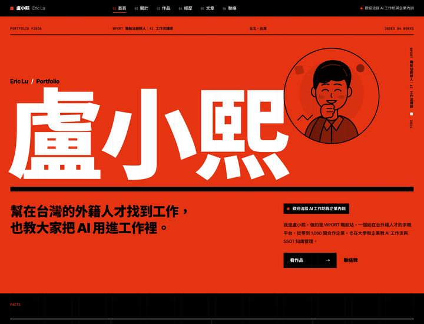
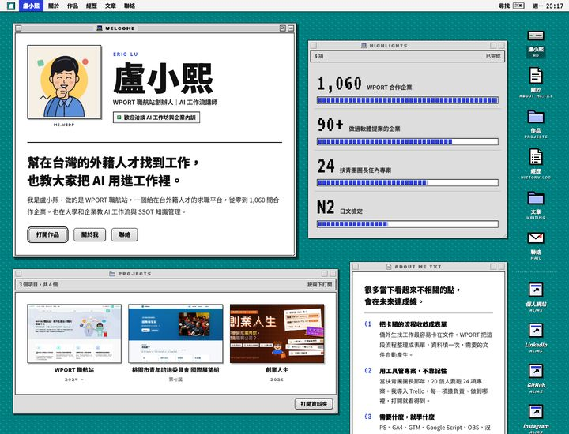
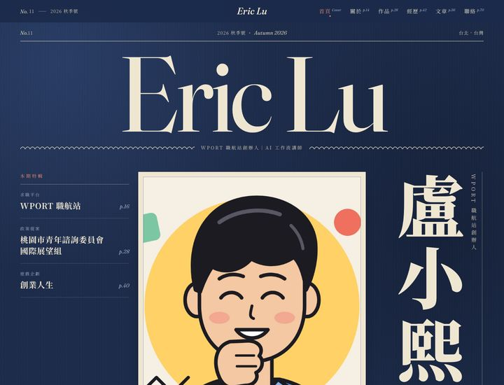
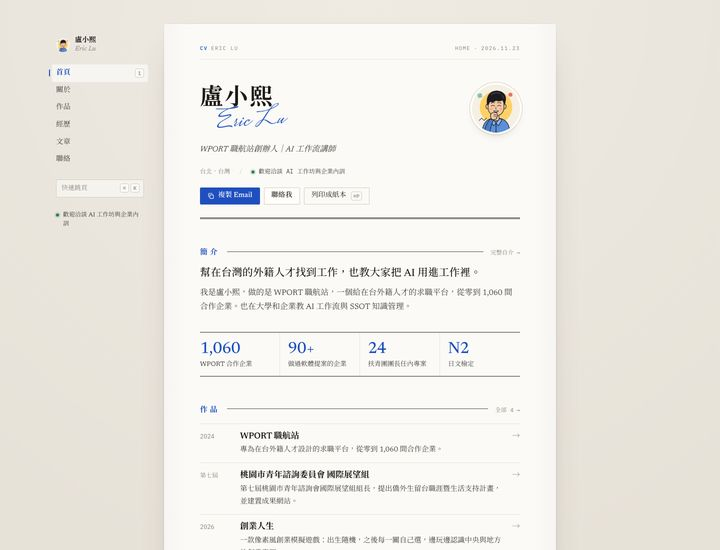

# 個人網站範本（Astro 版，10 種風格）

版型、動畫、手機版、分頁都做好了。你只要準備**內容**，選一個**風格**，就有一個多頁的個人網站：

- 首頁、關於、作品（列表＋每個作品一頁）、經歷、文章、聯絡，共 6 種頁面
- 10 種風格，每一種都是完整的一套網站（版型、動畫、手機版都不同），改一行設定就換，內容不用動
- GSAP 捲動動畫、平滑捲動；沒有放照片也有設計過的版面
- 推上 GitHub 自動部署到 GitHub Pages；也能放 Vercel、Cloudflare
- 聯絡表單可以接 Cloudflare Worker：留言存進 D1 資料庫，有網域還能寄信通知你（見 [`contact-worker/`](contact-worker/README.md)）

範例人物「盧小熙」是老師拿自己的資料和專案做的，全部換成你的。

## 10 種風格

先跑 `npm run themes`（約 30 秒），再點圖片或編號，就會在本機打開完整網站（每一頁都能點、動畫都會動）；10 種並排看：**[http://localhost:4400/](http://localhost:4400/)**

| | | |
|---|---|---|
| [](http://localhost:4400/01-editorial/)<br>**[01-editorial](http://localhost:4400/01-editorial/)** 瑞士海報：滿版紅、黑白交替、超大字 | [](http://localhost:4400/02-bento/)<br>**[02-bento](http://localhost:4400/02-bento/)** Apple 產品頁：白灰、筆電外框、捲動放大 | [](http://localhost:4400/03-minimal/)<br>**[03-minimal](http://localhost:4400/03-minimal/)** 像素冒險：深藍星空、角色卡、任務卡 |
| [](http://localhost:4400/04-aurora/)<br>**[04-aurora](http://localhost:4400/04-aurora/)** 液態玻璃：繽紛漸層、毛玻璃面板 | [](http://localhost:4400/05-brutal/)<br>**[05-brutal](http://localhost:4400/05-brutal/)** 新粗獷：米底、色塊、可拖的貼紙 | [](http://localhost:4400/06-terminal/)<br>**[06-terminal](http://localhost:4400/06-terminal/)** 復古桌面：綠松石桌面、可拖的灰視窗 |
| [](http://localhost:4400/07-magazine/)<br>**[07-magazine](http://localhost:4400/07-magazine/)** 藍染雜誌：深靛藍、直排、印章 | [](http://localhost:4400/08-studio/)<br>**[08-studio](http://localhost:4400/08-studio/)** 作品集工作室：暖黑＋螢光、大圖展開 | [](http://localhost:4400/09-soft/)<br>**[09-soft](http://localhost:4400/09-soft/)** 柔和黏土：粉嫩、Q 彈互動 |
| [](http://localhost:4400/10-cv/)<br>**[10-cv](http://localhost:4400/10-cv/)** 紙本履歷：永遠淺色、襯線、可列印 |  |  |

自己的內容換好之後跑 `npm run themes`，打開 http://localhost:4400/ 會看到 **11 個版本**：你第 1 堂用聊天 AI 做的一頁式（`code_artifact.html`）＋用**你的內容**做出的 10 種風格，每一個都能點進去操作。

第 1 堂做的一頁式：把你自己的 `code_artifact.html` 放在資料夾最上層，蓋掉範例那份（範例是老師的）。

## 怎麼用（三步）

需要：Node.js 24 LTS、Git、GitHub CLI（`gh`）。課前安裝見 https://wport.me/services/ai-training/prepare

### 1. 網頁版 AI 寫內容（Gemini／ChatGPT 免費版）

內容要寫得好，網站才會好看；這一步交給比較聰明的網頁版 AI。

1. 先讓它訪問你（或貼上你的 `我的資料.md`）。
2. 同一個對話裡，貼上 [`網頁版AI-prompt.md`](網頁版AI-prompt.md) 的全部內容。
3. 下載它給的 `網站內容.md`，放在「下載」資料夾，檔名不要改。

### 2. 開專案、匯入內容（OpenCode）

在桌面開一個資料夾（例如 `my-site`），用 OpenCode 打開，貼上：

```
# 1. 拿範本（.github、.gitignore 也要一起搬）
run: git clone --depth 1 https://github.com/contactwport/wport-ai-starter-kit.git _kit
run: node -e "require('fs').cpSync('_kit/templates/website/astro','.',{recursive:true})"
run: node -e "require('fs').rmSync('_kit',{recursive:true,force:true})"
# 2. 安裝、匯入內容、檢查
run: npm install
run: npm run import          # 會自己到「下載」資料夾找 網站內容.md
# 3. 只回報上面指令的結果，不要改其他檔案
```

成功後跑 `npm run dev`，打開它給的網址（通常是 http://localhost:4321）看網站。之後改了 `site.config.mjs`（換風格、主色），再跑一次 `npm run dev` 就會套用。

### 3. 選風格、上線

```
# 選風格
edit: site.config.mjs 的 theme 改成 '05-brutal'   # 換成你要的編號
run: npm run build
# 上線到 GitHub Pages
run: git init && git add . && git commit -m "我的個人網站"
run: gh repo create my-site --public --source=. --push
run: gh api -X POST "repos/{owner}/{repo}/pages" -f build_type=workflow
# 回報網址：https://<你的帳號>.github.io/my-site/
```

之後每次 `git push`，網站一兩分鐘內自動更新。

## 之後想改

| 想做的事 | 怎麼做 |
|---|---|
| 改內容 | 網頁版 AI 改好重新下載，再跑一次 `npm run import`（舊內容會自動備份到 `.backup/`）；或直接改 `src/content/` 裡的檔案 |
| 加大頭照 | 照片放 `public/images/me.jpg`，`profile.md` 的 `avatar` 填 `/images/me.jpg` |
| 作品加封面 | 照片放 `public/images/`，作品的 `cover` 填 `/images/檔名.jpg`；沒照片會自動產生色塊封面 |
| 換主色 | `site.config.mjs` 的 `accent` 填色碼，例如 `'#1F5FAF'` |
| 加作品 | 複製 `src/content/projects/wport.md`，改英文檔名和內容 |
| 不想要文章頁 | 刪掉 `src/content/posts/` 裡的檔案，導覽列會自動拿掉 |
| 聯絡表單 | 照 [`contact-worker/README.md`](contact-worker/README.md) 做，再把網址填進 `site.config.mjs` 的 `contactEndpoint` |

## 資料夾

```
site.config.mjs        ← 風格、主色、表單網址（你會改的設定都在這）
code_artifact.html     ← 第 1 堂用聊天 AI 做的一頁式網站（換成你的；npm run themes 會一起比較）
src/content/           ← 網站內容（你會改的內容都在這）
  profile.md             個人資料＋自傳
  projects/*.md          作品
  experience/*.md        經歷
  posts/*.md             文章
public/images/         ← 照片
contact-worker/        ← 聯絡表單（Cloudflare Worker＋D1）
網頁版AI-prompt.md     ← 貼給 Gemini／ChatGPT 的 prompt
AGENTS.md              ← 給 OpenCode 的規則
src/themes/            ← 10 種風格（不要改）
src/components/ …      ← 版面程式（不要改）
```

## 不要放進 repo 的東西

Public repo 誰都看得到：手機、地址、生日、身分證字號、帳號密碼、API Key 都不要放。

## 給老師：改範本

- 每個風格是一套完整的版面：`src/themes/<編號>/` 裡有自己的 `Layout.astro`、`pages/`、元件和 CSS。怎麼做、要遵守什麼，見 [`src/themes/README.md`](src/themes/README.md)。
- 共用的只有資料讀取（`src/lib/site.ts`）、`<head>`（`src/shared/Seo.astro`）、聯絡表單（`src/shared/ContactForm.astro`）、動畫工具（`src/lib/motion.ts`：GSAP、ScrollTrigger、SplitText、Lenis）。
- 檢查一個風格的每一頁：`npm run shoot -- 05`（桌機＋手機截圖到 `theme-previews/05-brutal/`）；加 `--no-images` 看學生還沒放照片時的樣子。
- 改了範例內容，要跑 `npm run prompt` 重新產生 `網頁版AI-prompt.md`（範例是從 `src/content/` 打包的）。
- 改了風格，跑 `npm run themes` 看 10 種並排；README 的預覽圖在 `previews/`。
- 範例照片與截圖的來源見 `public/images/CREDITS.md`。
